<h1 align="center">Presto-Pet</h1>

<p align="center">
  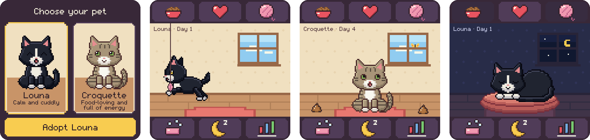
</p>

<p align="center">
  <b>A cosy virtual pet for the <a href="https://shop.pimoroni.com/products/presto">Pimoroni Presto</a></b><br>
  RP2350 · 480 × 480 touch screen · MicroPython · English and French
</p>

Adopt a cat, feed her, cuddle her, play ball or feather, brush her and tuck her in. She lives in real
time for days and weeks, sleeps at night, asks for attention when she needs something, and
**never dies**: a neglected pet gets hungry or sulky, never lost. Made to be gentle with
children: no constant attention required, no punishment. In the spirit of the 1990s pocket
pets, with original pixel art.

| | | |
|---|---|---|
| 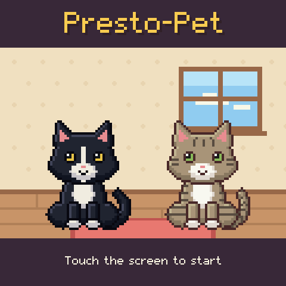 | 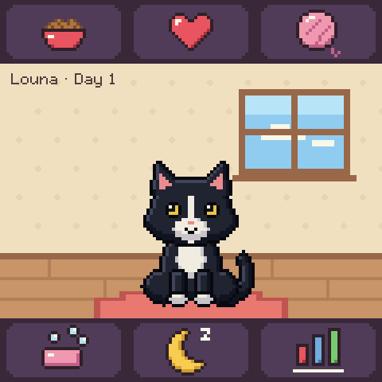 | 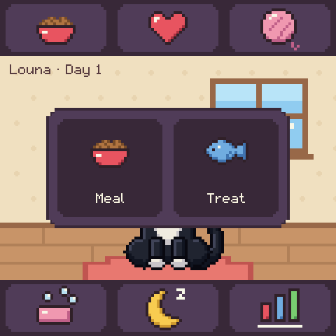 |
| 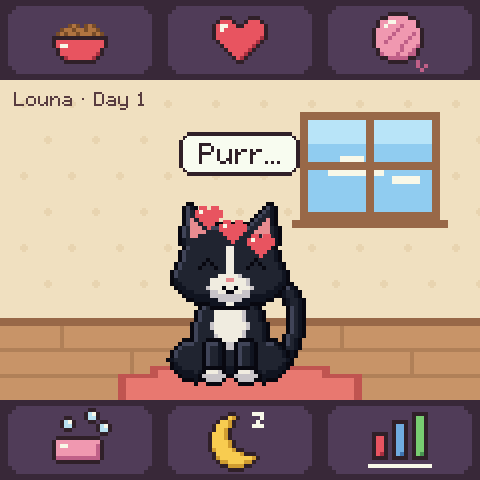 | 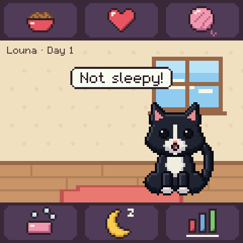 | 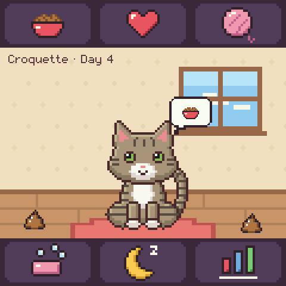 |
| 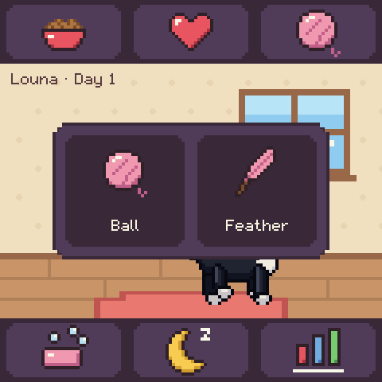 | 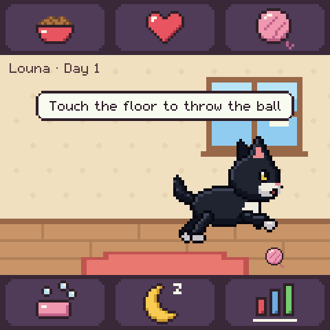 | 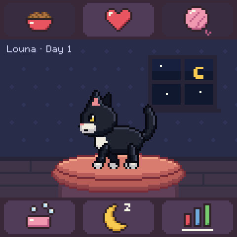 |
| 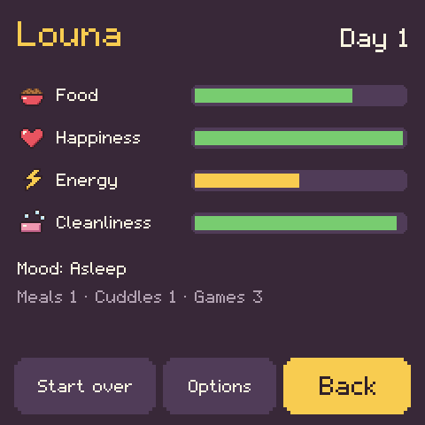 | 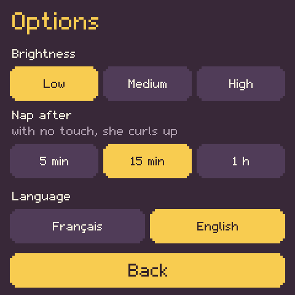 | 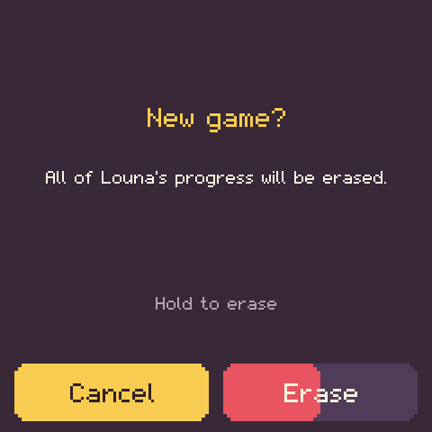 |

> **Status: 0.1, first playable version.** The game logic is covered by unit tests, the
> whole interface runs in a desktop simulator (screenshots above), and it has been played on
> a real Presto (see [Known limits](#known-limits)).

## Features

- Two cats to adopt: **Louna**, black and white, calm and cuddly, and **Croquette**,
  grey-brown tabby and white, food-loving and full of energy. One pet per game; starting over needs
  a deliberate long press.
- Touch menus around the room, like the icons of the original toys: **feed** (meal or treat),
  **caress** (or touch the pet), **play**, **clean**, **sleep**, **statistics**.
- Two toys. The **ball**: touch the floor to throw it, she gallops after it, crouches with
  her hindquarters wiggling, and pounces on it. The **feather** on its string: slide your
  finger to wave it; she follows it, and when it comes within reach she crouches and leaps
  for it, as high as it hangs.
- Four needs that evolve with real time: food, happiness, energy, cleanliness. Age in days.
- A life of her own: she sits, blinks, turns to walk or hop across the room in profile,
  licks a paw, stretches with her rear in the air and yawns, calls you with a bubble showing
  what she needs, falls asleep when tired or at night, and wakes up in the morning. Meals lead
  to small messes to clean.
- Her eyes follow your finger on the floor. Now and then, by day, a bird or a butterfly passes
  behind the window: she watches it, her jaw chattering.
- Going to bed is a little ritual: she climbs on her cushion, turns round on it, kneads it,
  then curls up. Wake her up meanwhile and she simply stays up.
- Every action has a visible reaction, including friendly refusals ("Not hungry!").
- A caress makes her purr, and the 7 LEDs on the back of the Presto play a small pink light
  show: the glow spreads from the middle and beats like a heart.
- Left alone, she curls up for a nap after 5 minutes, 15 minutes or an hour without a touch,
  and stays curled up until someone comes back: the napping cat is the screen saver.
- Options (from the statistics): brightness (low, medium, high), the nap delay and the
  language. They apply at once and are kept when starting over.
- Crisp pixel art drawn with rectangles only, light enough for MicroPython: only the parts
  of the screen that change are redrawn and sent to the panel.
- Robust saving and automatic resume, with the time spent switched off taken into account.
- English and French, chosen in the Options; the messages follow the pet's gender.

## Rules of the game

| Need | Goes down | Restored by |
|---|---|---|
| Food | ~5 points an hour awake, slower asleep | a meal (+40), a treat (+8, makes her happy) |
| Happiness | slowly, faster when hungry or dirty | caresses, play (ball or feather), treats |
| Energy | while awake, faster when playing | sleep (a night restores everything) |
| Cleanliness | slowly, faster with messes on the floor | the brush, which also removes messes |

- Values go from 0 to 100. Nothing bad happens at 0: she sulks (plays half-heartedly),
  looks tired or asks for help, and always recovers with a little care.
- Repeated caresses and treats in a row help less and less, so care is spread over the day.
- A game is a ball caught, or the feather caught in a leap; a session ends after five games,
  when she is too tired, or after 25 seconds without a throw or a wave.
- When the time of day is known, nights last from 21:00 to 07:00 local time. Woken up at
  night, she stays up for half an hour before going back to bed.
- After an absence of more than 6 hours, she is glad to see you again.
- A nap ends with a touch, which only wakes her up. A nap that reaches the night becomes her
  night's sleep, and she wakes up in the morning as usual.
- Each cat has a small personality: multipliers on the species rules
  (`src/prestopet/pets/louna.py`, `croquette.py`).

## Installation on the Presto

### 1. Firmware

Flash the Pimoroni MicroPython firmware for the Presto
([pimoroni/presto releases](https://github.com/pimoroni/presto/releases)). Presto-Pet only
uses what it provides: PicoGraphics, the touch panel and, optionally, the network. No font,
image or library needs to be installed.

### 2. Copy the game

Install [mpremote](https://docs.micropython.org/en/latest/reference/mpremote.html)
(`pip install mpremote`), connect the Presto by USB, then from this repository:

```sh
tools/deploy.sh try       # copies only the prestopet/ folder and runs the game once; a reset
                          # brings back the program that starts at boot
tools/deploy.sh install   # saves the device's current main.py to main.py.device-<date>.bak,
                          # then makes Presto-Pet start at boot
```

`install` copies `src/main.py` and the `src/prestopet/` folder to the root of the device, and
`src/config.py` only when the device has no `config.py` yet. By hand, with Thonny or mpremote, the layout on the Presto is:

```
/main.py
/config.py
/secrets.py               optional, for the clock (see below)
/prestopet/*.py
/prestopet/pets/*.py
/prestopet_save.json      written by the game
/prestopet_settings.json  the options, written when one changes
```

To go back to the previous program, copy the backup over `main.py`
(`mpremote cp main.py.device-<date>.bak :main.py`). The game's save file stays on the device
until you delete it.

### 3. Optional: the clock

The Presto has no battery-backed clock. Presto-Pet works without network, but it can only
take the time spent switched off into account once the clock is set:

- with **Wi-Fi**: create `secrets.py` from `src/secrets.example.py` (`WIFI_SSID`,
  `WIFI_PASSWORD`, the names used by Pimoroni's examples). The game connects in the
  background, sets the clock by NTP, then turns the radio off; it does it again every
  12 hours. Nothing else is ever sent;
- or from the computer: `mpremote rtc --set` while the Presto is connected.

### 4. Settings

In the game, Statistics then Options: brightness, the nap delay and the language.

`config.py`: the language at first start (`fr`, `en`; the choice made in the Options then
wins), time zone (offset and European summer time), and an
optional delay before the screen goes dark (off by default; a touch lights it again and the
pet keeps living).

## How time and saving work

- **Real time.** The simulation advances with elapsed time, not with frames: the loop can be
  slow (it is when the screen is dark) and nothing is lost.
- **Switched off.** At boot, if the clock is set, the time since the last save is simulated
  at once in 5-minute steps; beyond 3 days the pet only ages, since needs have long settled.
- **Clock unknown.** The game resumes as if no time had passed and counts time with the
  monotonic counter. If the clock is set later (Wi-Fi), the missing offline time is
  discovered and simulated then. Nights are ignored until the time of day is known.
- **Saving.** One save, written atomically: new content in a temporary file, previous save
  kept as a backup, then a rename. A power cut at any moment leaves a complete save.
- **Flash wear.** Actions are grouped (one write about 15 s after a burst of taps), urgent
  changes (adoption, sleep) are written at once, otherwise every 10 minutes: at most about
  150 writes a day when nobody plays. Losing the last minutes is harmless since the elapsed
  time is simulated again from the saved timestamp.

## Development

Everything runs on a computer with Python 3, without the Presto.

```sh
python3 -m unittest discover -s tests          # engine, clock, saving, touch, sprites, interface
python3 tools/simulator.py --play              # play in a window: the mouse is the finger (Pillow, Tk)
python3 tools/simulator.py --lang en           # plays a scenario, writes docs/screenshots and
                                               # the README banner docs/hero.png (Pillow)
python3 tools/build_sprites.py                 # regenerates the cat art, awake and asleep
```

The simulator runs the real game with a fake Presto. Its display keeps the frame buffer and
the panel apart, as the device does, and reports any screenshot where a changed region was
not sent to the panel.

In the window (`--play`, add `--zoom 2` for a bigger one, `--lang en` for English), click
to tap and keep the button down to hold. `H` moves time forward by one hour and `D` by one
day. The game is saved in `.sim/`, and the time spent with the window closed is caught up on
the next launch, as on the device.

To check MicroPython syntax: `pip install mpy-cross`, then
`find src -name '*.py' -exec mpy-cross -o /dev/null {} \;`.

### Why the awake cat is generated as tables

On the Presto, Python is slow to create objects: composing a frame of the cat from patches
and cutting its rows into runs of colour took 40 to 300 ms, and the walk stuttered. So
`tools/build_sprites.py` draws every pose (sitting, eating, and in profile: standing,
walking, hopping, crouched, stretching) for every combination of the parts that change a
row (eyes, mouth, ears, tail, paws or legs), and writes, for each row, its runs of colour
as bytes. On the device a frame is one table lookup per row, and its runs are drawn as they
are. Measured on a Presto: about 25 ms for a frame of the walking cat (most of it filling
pixels), 50 ms at worst. The sleeping cat and the props keep the simpler base-and-patches
images, which change little.

### Architecture

```
src/
  main.py                 entry point on the device
  config.py               user settings
  prestopet/
    engine.py             the pet and the rules: needs, moods, actions, autonomy (pure Python)
    species.py            species rules as numbers; personalities multiply them
    game.py               pet + game time + saving, without display (tested end to end)
    clock.py              trusted or estimated wall time, offline gaps, local hour
    storage.py            atomic save file and the policy that limits flash writes
    settings.py           the options (brightness, nap delay, language), in their own file
    leds.py               the light show of the LEDs on the back
    touch.py              taps and long presses from raw touch samples
    pets/                 the characters and their art (content, no logic)
      louna.py, croquette.py          name, species, personality, palette
      coat_tuxedo.py, coat_tabby.py  awake art (front, profile, crouched, stretching) as tables, generated
      sleep_tuxedo.py, sleep_tabby.py  curled up asleep, generated too
    sprites.py            images drawn as runs: base and patches (asleep, icons), tables (awake)
    canvas.py             drawing on PicoGraphics, regions sent with partial_update
    font.py               pixel font with French accents
    art.py                interface colours, icons and props (ball, feather, bird, butterfly)
    petview.py            animation of the pet: gaits, pounces, glances, bedtime, asleep, zZZ
    scene.py              the room, the feather toy, the window visitors, and a small
                          compositor redrawing only what changed
    screens.py            title, choice, room, statistics, options, new game
    i18n.py               texts
    hardware.py           the only module that talks to the Presto firmware
    app.py                main loop
tests/                    unit tests (CPython)
tools/                    sprite generator, simulator, deployment
```

Dependencies only go downwards: the engine knows nothing about drawing or the device, the
interface reads the engine and calls its actions, and the firmware is reached in one place.

### Adding a pet

1. Create `src/prestopet/pets/<id>.py` with a `CHARACTER` dict (see `louna.py`): name,
   gender (for the messages), species, personality, coat, palette, cushion colours, traits.
2. Add its id to `CHARACTERS` in `src/prestopet/pets/__init__.py`.
3. Art: reuse a coat with a new palette (an orange tabby is `coat: "tabby"` with other
   colours), or add a coat pattern in `tools/build_sprites.py` and run it: it draws the
   coat awake and curled up asleep, with the zones that breathe and twitch.
4. A new species is a new dict in `species.py`: the engine reads only numbers.

`python3 -m unittest discover -s tests` checks that every character is complete.

### Adding a language

Add a table to `TEXTS` in `src/prestopet/i18n.py` (missing keys fall back to English), its
name to `LANGUAGE_NAMES`, and its code to `LANGUAGES` in `src/prestopet/settings.py`. The
pixel font covers the French accents; the tests list any character it cannot draw. The
Options screen shows two language buttons side by side: a third needs a narrower layout.

## Contributing

Issues and pull requests are welcome: new pets, coats, translations, mini-games, fixes. Please
run the tests and the simulator scenario before sending a change (`python3 -m unittest
discover -s tests`, `python3 tools/simulator.py --lang en`), keep the code MicroPython
friendly (no f-strings with `=`, no dataclasses, no typing at run time) and regenerate the
art with `tools/build_sprites.py` rather than editing the generated files by hand.

## Known limits

Tried on a Presto: screens, touch, animations and the Wi-Fi clock work. Still to improve
or check:

- each step of a moving cat redraws the room under it: about 25 ms on the device, fine
  for the gaits, but nothing much bigger should move at once;
- curling up redraws the whole room in its night colours (about 0.4 s, once);
- the order of the LEDs on the back (the light show assumes they are in a row);
- the medium and high brightness levels (0.2 and 1.0 passed to `set_backlight`);
- the import time of the modules, about 0.5 s for each coat table (they can be precompiled
  to `.mpy` with `mpy-cross`).

## Ideas for later

Mini-games, more foods and toys, the real weather at the window, growing up stages, other animals and coats, a few sounds,
several save slots, a day/night light that follows the real sky.

## Credits

All the art is generated by `tools/build_sprites.py`. The breathing and twitching technique
and the rising zZZ come from an earlier Presto screen saver by the same author. Released under the [MIT licence](LICENSE).
# presto-pet
